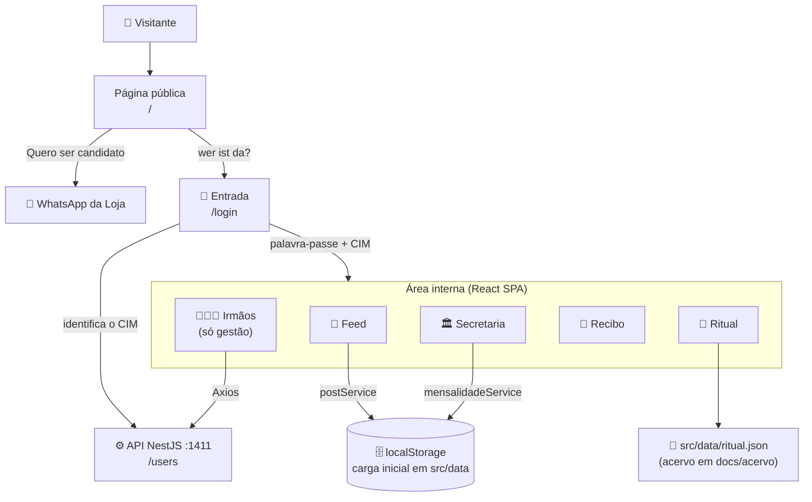

<div align="center">

# 🏛️ Loja 43 - app-fmo

**Site e área interna da A∴R∴L∴S∴ Flaviano Mendes de Oliveira Nº 43**  
React 19 · TypeScript · Tailwind · shadcn/ui · Recharts


</div>

---

## Sobre o projeto

Aplicação web da **Loja Maçônica Flaviano Mendes de Oliveira Nº 43**, do Rito Schröder, no Recife. São dois lados na mesma aplicação: a **página pública**, que apresenta a Loja, sua história, o Rito, a gestão, a galeria e o convite a candidatos; e a **área interna**, onde os irmãos entram pela palavra-passe para ler o feed, acompanhar o Ritual de Aprendiz e conferir a secretaria (mensalidades, caixa e tronco).

A gestão (Venerável e Vigilantes) publica no feed, edita o mês aberto da secretaria, emite recibo de mensalidade e mantém o cadastro de irmãos. Os demais irmãos leem e comentam.

## Telas e funcionalidades

### Página pública

| Área | O que faz |
|------|-----------|
| 🖼️ **Galeria e carrossel** | Fotos das sessões e rituais, com ampliação em tela cheia |
| 📜 **História e Rito** | Quem foi Flaviano Mendes de Oliveira e o que é o Rito Schröder |
| 👥 **Gestão atual** | Venerável Mestre e Vigilantes com foto |
| 📅 **Calendário** | Dia, horário e endereço das sessões, com mapa do templo |
| 📱 **Quero ser candidato** | Formulário que monta a mensagem e abre o WhatsApp da Loja |

### Área interna

| Área | O que faz |
|------|-----------|
| 🔐 **Entrada** | Palavra-passe única da Loja e CIM opcional, que identifica o irmão (nome, grau e se é da gestão) |
| 📰 **Feed da Loja** | Avisos da gestão em destaque dourado, comentários de qualquer irmão, limite de 600 caracteres |
| 📖 **Ritual de Aprendiz** | Leitor em tela cheia com 36 capítulos, navegação por teclado, tamanho de fonte e alto contraste |
| 🏛️ **Secretaria** | Saldo mensal e tronco em gráfico de barras, pagos e irregulares do último mês em pizza, balancete anual com filtro por ano e mês |
| ✍️ **Edição do mês** | A gestão marca quem pagou no mês aberto, ajusta o tronco e oferece o recibo na hora |
| 🧾 **Recibo** | Recibo de mensalidade gerado em imagem, para baixar ou copiar e mandar ao irmão |
| 🧑‍🤝‍🧑 **Irmãos** | Cadastro (nome, CIM, grau, celular, senha) mantido pela gestão contra a API |

## Arquitetura



> **Dados locais:** mensalidades e feed ainda não existem na API. O service de cada um lê a carga inicial de `src/data/*.json` e guarda as edições no `localStorage` do navegador. Quando a API ganhar esses recursos, a troca é só dentro do service.

## Stack

- **React 19** + **TypeScript**
- **shadcn/ui** + **Radix UI** - componentes acessíveis (diálogo, rótulo)
- **Tailwind CSS** - tema com a paleta da Loja (azul maçônico, dourado ritual, marfim), tokens em `src/index.css`
- **Recharts** - gráficos da secretaria
- **React Router v7** - navegação, com lazy import por tela
- **Axios** - chamadas à API, com `extractError` para a mensagem que chega à tela
- **Sonner** - notificações · **Lucide React** - ícones
- **html2canvas** - recibo em imagem

## Rodando localmente

**Pré-requisitos:** Node 22+, npm. A API NestJS em `http://localhost:1411` é necessária só para o cadastro de irmãos; o restante funciona sem ela.

```bash
git clone https://github.com/dennysnascimento/app-fmo.git
cd app-fmo
npm install
```

Copie e ajuste as variáveis de ambiente:

```bash
cp .env.example .env   # defina a REACT_APP_PALAVRA_PASSE
```

Inicie o servidor de desenvolvimento:

```bash
npm start
```

A aplicação estará em `http://localhost:3000`. Para entrar como gestão, use um CIM da gestão (`1001`, `1002` ou `1003`) e a palavra-passe do `.env`.

## Build de produção

```bash
npm run build
```

Os arquivos estáticos ficam em `build/` e são servidos pelo nginx do `Dockerfile`:

```bash
docker build --build-arg REACT_APP_API_URL=https://api.exemplo.com.br --build-arg REACT_APP_PALAVRA_PASSE=... -t app-fmo .
docker run -p 8080:80 app-fmo
```

## Variáveis de ambiente

| Variável | Descrição |
|----------|-----------|
| `REACT_APP_API_URL` | URL da API NestJS, sem barra no fim. Padrão: `http://localhost:1411` |
| `REACT_APP_PALAVRA_PASSE` | Palavra-passe da área interna. Sem ela definida, a entrada recusa qualquer tentativa |

## Estrutura do projeto

```
src/
├── components/       # Layout (sidebar + topo), ProtectedRoute, TituloPagina, Logo
│   └── ui/           # button, input, label, textarea, select, switch, badge, card, table, dialog
├── contexts/         # AuthContext (sessão, CIM, gestor)
├── lib/              # caixa.ts (saldo do mês), gestao.ts (CIMs da gestão), formato.ts, utils.ts
├── pages/
│   ├── publico/      # Inicio (página pública, CSS próprio)
│   ├── auth/         # Login
│   ├── loja/         # Feed
│   ├── ritual/       # Ritual (leitor em tela cheia, CSS próprio)
│   ├── secretaria/   # Secretaria, Recibo
│   └── usuarios/     # Irmaos (cadastro, só gestão)
├── services/         # api.ts, usuarioService, mensalidadeService, postService
├── types/            # Usuario, Mensalidade, Post, Ritual
├── data/             # Carga inicial: usuarios, mensalidades, posts e ritual em JSON
└── assets/           # Logos, fotos da gestão, banners e vídeo

docs/acervo/          # Texto-fonte do Ritual de Aprendiz (GLMERGS, 2007)
```

A página pública e o Ritual ficam fora do `Layout`: a primeira é o site da Loja para quem vem de fora, o segundo é leitura em sessão, sem menu do sistema em cima. Todo o resto da área interna compartilha a sidebar e o topo.

## Convenções da interface

- Texto de sistema sem exclamação e sem emoji; humor fica para o feed
- Botão diz a ação (`Publicar`) e a confirmação repete o verbo (`Publicado`)
- Erro diz o que aconteceu e o que fazer, pelo `toast`
- O que é só da gestão some do menu e é barrado na rota (`ProtectedRoute somenteGestor`)
- Cor da marca pelos tokens do Tailwind; a paleta da página pública é a mesma da área interna

## Perfis de acesso

| Perfil | Acesso |
|--------|--------|
| **Visitante** | Página pública e formulário de candidato |
| **Irmão** | Feed (leitura e comentário), Ritual, Secretaria (leitura) e recibo próprio |
| **Gestão** (CIMs `1001`, `1002`, `1003`) | Tudo do irmão, mais publicar no feed, editar o mês aberto, emitir recibo e manter o cadastro de irmãos |

---

<div align="center">
  <sub>Projeto original de <a href="https://github.com/alamy/app-fmo">alamy/app-fmo</a></sub>
</div>
